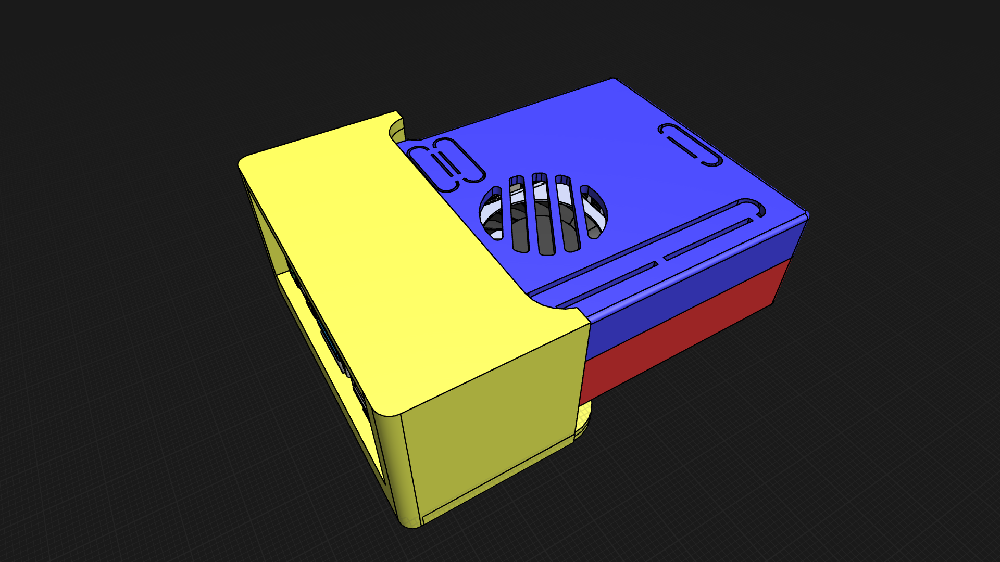
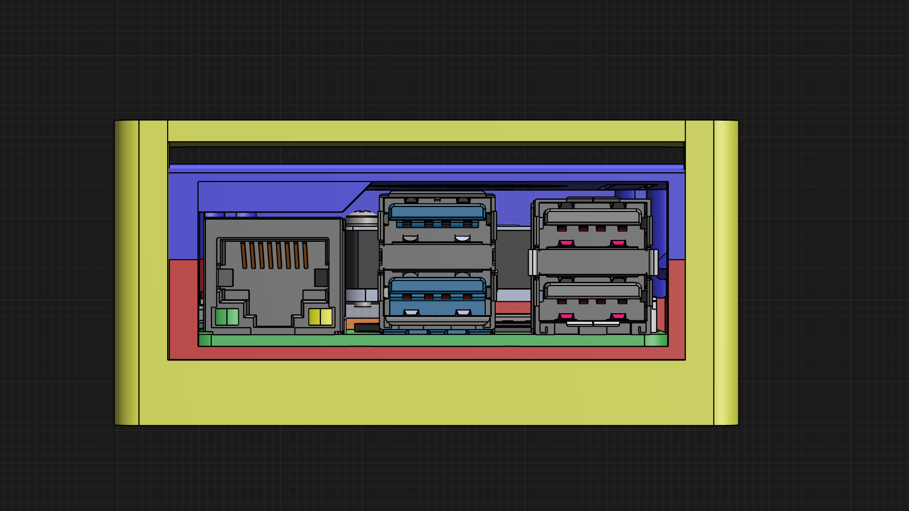
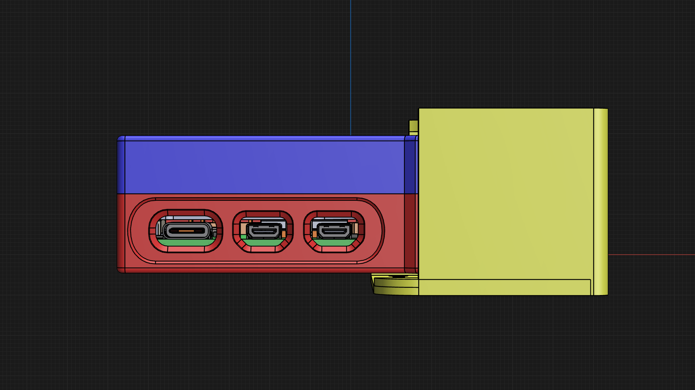
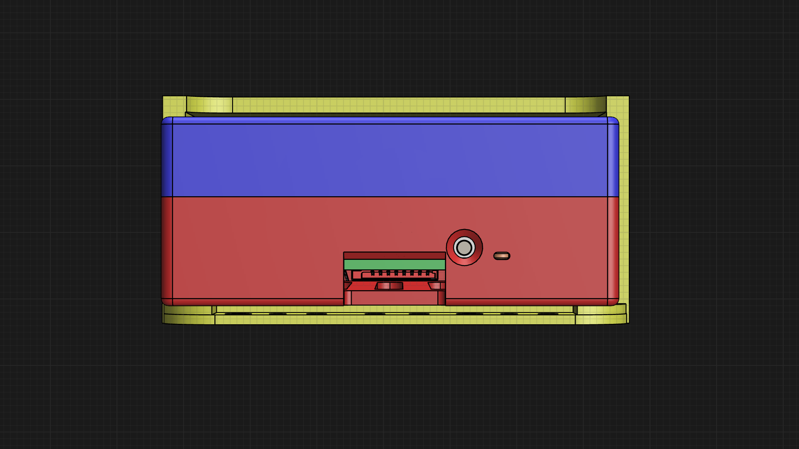
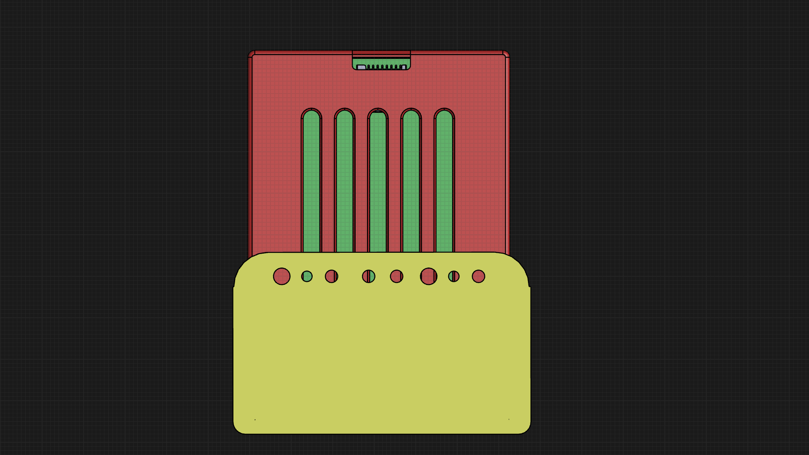
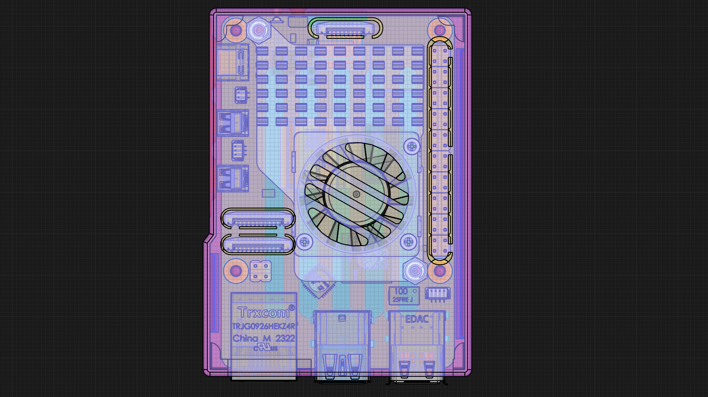
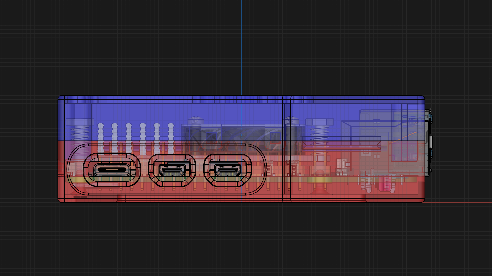
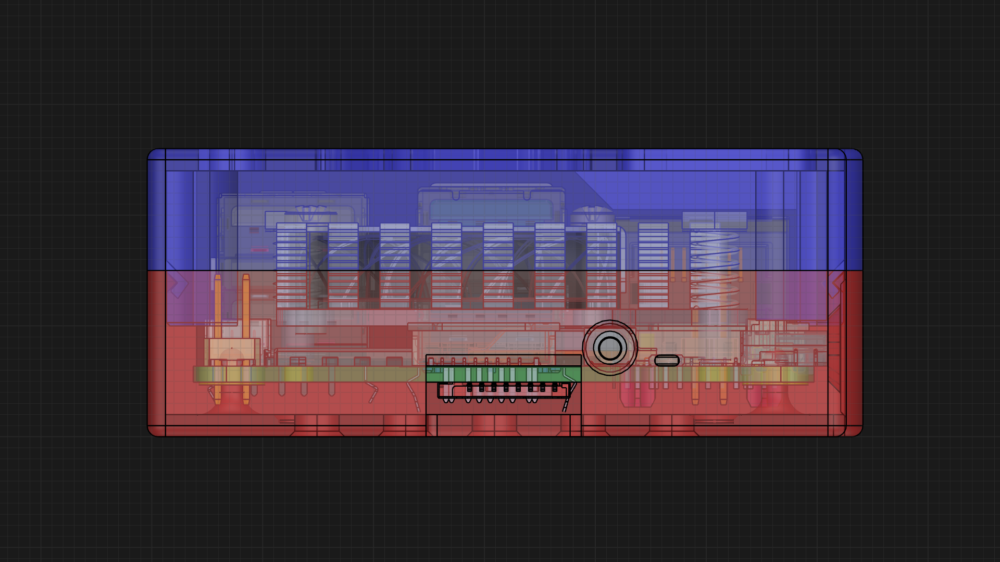
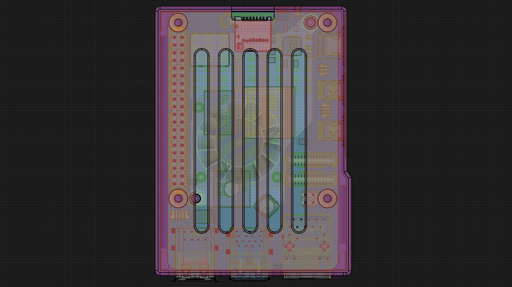

# Raspberry Pi 5 Protective Case & Custom Wall Mount

  

This project features a custom-designed Raspberry Pi 5 case that provides full I/O access alongside a specialized quick-release wall mount. Utilizing a secure slide-in mechanism, the Pi can be easily mounted by sliding it down into place, and removed just as quickly by sliding it up.

## Gallery

### Lookaround

  
  
  
  

<i>1st: Front Profile. 2nd: Left Profile. 3rd: Back Profile. 4th: Bottom Profile</i>

### I/O Accessibility

  
  
  
  

<i> X-Ray view of the internal Pi alignment.</i>

## Key Features

- **Complete I/O Access**
- **Snap-Fit Latch Mechanism**
- **Optimized Thermal Vents**
- **Quick-Release Wall Mount**

## Bill of Materials (BOM)

To build and assemble this project, you only need to **3D print the custom parts** and mount it. I don't have a 3D printer otherwise i would have stated the print settings as well.

## Project Structure

- 📂 [CAD Files](./CAD%20Files/) — The raw CAD design files for each part.
- 📂 [3d Print Files](/3d%20Print%20FIles/) — This contains 3mf files for each part.
- 📂 [production](./production/) — Files containg the whole case completely assembled and a .shapr file for the project containing the whole project history.
- 📝 [journal.md](./journal.md) — Journal entries
- 📂 [media](./media/) — All the project media

### [This file](/production/Raspberry%20pi%205%20case.shapr) contains the complete project with all the parts assembled and a history of the project.

> you would need to open it in shapr3D to view the project and its history.

## Process Timelapses

> the first lapse recording was corrupted due to [this reason.](/journal.md###abc)

- [Phase 1: Base Design Timelapse](https://lapse.hackclub.com/timelapse/8aHeTkuYrUJS) (July 8, 2026)
- [Phase 2: Enclosure & Mounting System Timelapse](https://lapse.hackclub.com/timelapse/01FLUsnRcBFR) (July 12–14, 2026)
