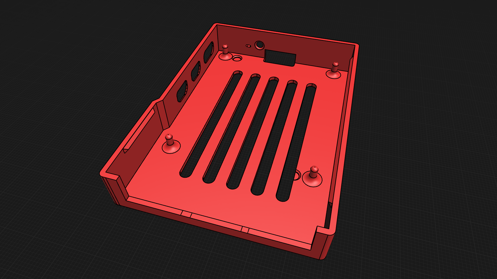
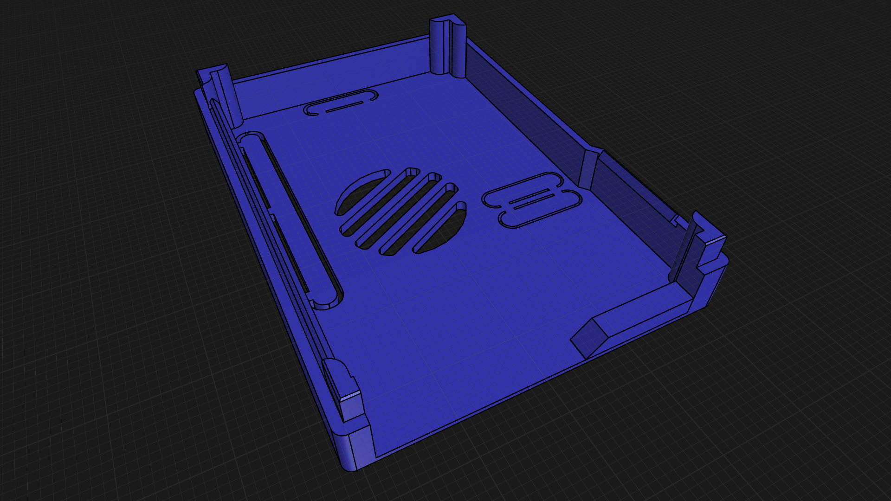
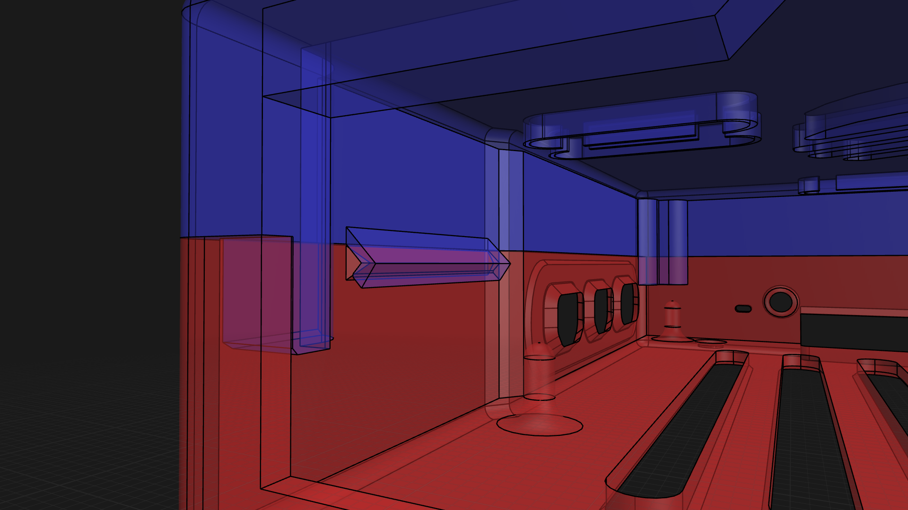
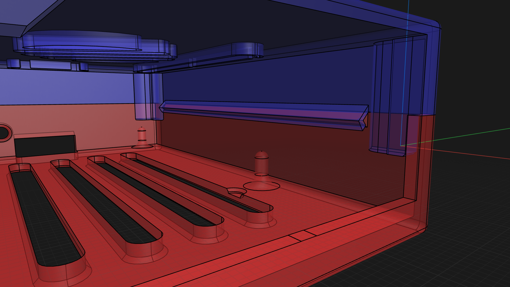
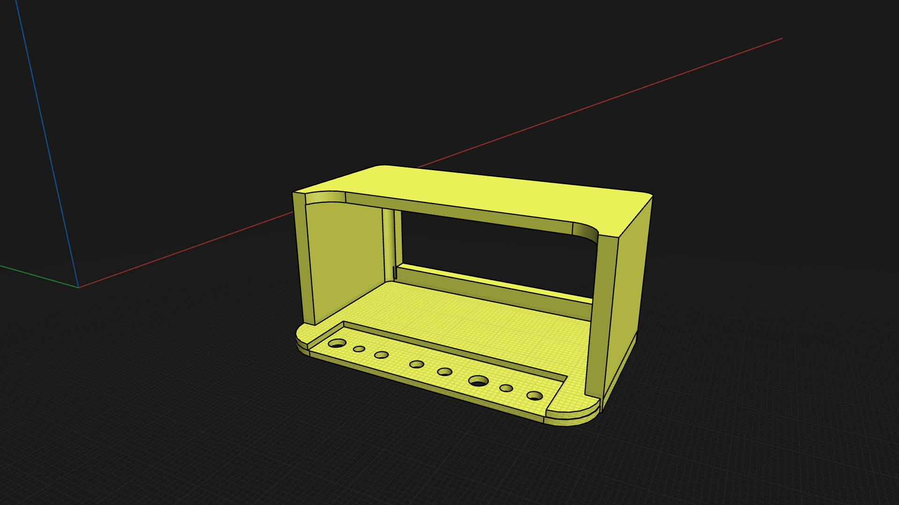
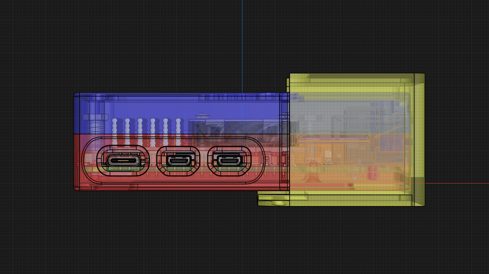
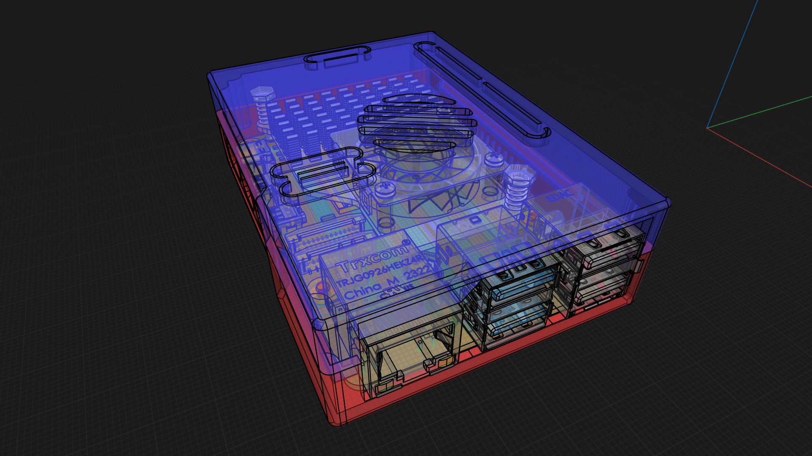
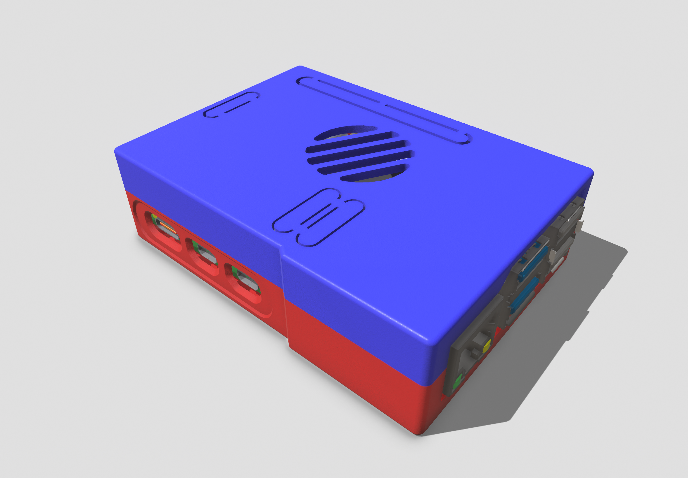

## Timeline & Log Summary

| Date                 | Phase / Milestone              | Tasks Completed                                                                       | Time Spent              |
| :------------------- | :----------------------------- | :------------------------------------------------------------------------------------ | :---------------------- |
| **July 8, 2026**     | **Phase 1: Base Design**       | Set up references, and made the base of the case                                      | 1h 00m                  |
| **July 12–14, 2026** | **Phase 2: Enclosure & Mount** | Designed the side walls, top enclosure, and custom wall mount.                        | 7h 33m                  |
| **July 15, 2026**    | **Phase 3: Documentation**     | Wrote journal entries, created the README, and compiled project files for submission. | _Tracked via Hackatime_ |

# July 8th: Made the base of the case!

Today i started the project. First of all i got the file set up by including a 3d modal of the Rasberry pi 5 itself and a already made case in the file for reference as well as this would be my first time making a case.(Don't really have much CAD experience before) but i knew the basics and i was able to figure things out as the software i am using is very beginner friendly. (Shapr 3d)

I started out by inspecting the premade case and then i started to make the base of my case. For that what i did was i made used the 3d modal of the Rasberry pi 5 itself to make sketches around it so that i could make a case with good fitting. It's been quite a while since i have done any CAD work so it took me some time to figure some things out. Then on the base i made extrusions for the pi to sit in. I also made a square hole on the side for accessing the SD card as well.

---

<figure>
  
  <figcaption align="center"><i>Figure 1: Base of the case, with the reference case visible on the left</i></figcaption>
</figure>

### **Total time spent: 1h**

### abc

But the saddest part was i used lapse web on iPad to record my work and when at the end of the session i realized the whole recording was basically useless as lapse web basically couldn't capture my screen in the background for some reason and failed to take screenshots. idk what to do about it but i have included it in the project.

### [Lapse video](https://lapse.hackclub.com/timelapse/8aHeTkuYrUJS)

<figure>
  <video src="media/timelapse%201st.mp4" controls width="100%"></video>
  <figcaption align="center"><i>Timelapse 1: this was the recording that got fucked up</i></figcaption>
</figure>

# July 12th: Finished the case by making bottom and a top enclosure and a wall mount!

> i started a session on july 12th and paused and resumed it for a couple of days for it to be finished at July 14 but i guess i will write a single huge entry for the whole thing here.

I designed the bottom and top enclosure of the case and made a latching mechanism as well so they can be easily attached and detached. i also designed a custom wall mount for the case which allows the case to be mounted on a wall and removed from it easily. The wall mount has a slide in mechanism which allows the case to be slid down into place and removed by sliding it up. I also made sure that wall mount is thick enough to support the weight of the case and pi. the wall mount also has multiple screw holes.

### Design Evolution & Components

  
  

<i>Figure 2: CAD views of the bottom base (left) and top enclosure (right)</i>

The Pi is supposed to sit on the bottom case with 1mm of clearence on the tightest points. both the top and bottom cases have air inlets and outlets for ventilation.

---

### Latching & Fitment Mechanism

  
  

<i>Figure 3: Internal wireframe showing the snap-fit latching mechanism and mating lip</i>

Designed the latching mechanism with basically a lip and a latch. The latch is designed to be slightly larger than the lip so that when the top and bottom cases are pressed together, the latch will flex slightly and snap over the lip, holding the two pieces together securely. I defined a clearance of 0.2mm between the latch and the lip to ensure a tight fit while still allowing for easy detachment. I also added these support + guide extrusions on the inside of the top case to align the both cases correctly when placing them together.

### Wall Mount

  
  

<i>Figure 4: Custom wall mount bracket (left) and port/mount side-alignment orthographic view (right)</i>

First i had the idea to just make screw holes in the bottom of the case but then i thought what if i make a sliding latch on te bottom. I designed that on one side but then realized it won't be good and could break off cause the pi is heavy and would sit on it. Could have made it stronger by making it bigger or wider but that would make the case a lil more bigger then just switched to this idea of making a wall mount bracket which would be mounted on the wall and the case would slide into it. I designed the wall mount bracket to be 3mm thick for load-bearing stability.

### Visualizing the Complete Assembly

  
  

<i>Figure 6: Orthographic X-ray assembly (left) and final color-coded model render (right)</i>

Basically most of my time ended up being spent on making sure that the port holes are aligned and designed correctly. also i am kinda beginner in CAD so it took me some experimenting around the software to get used to it. But at the end i am quite happy with the final design.

### **Total time spent: 7h & 33m**

### [Lapse video](https://lapse.hackclub.com/timelapse/01FLUsnRcBFR)

<figure>
  <video src="media/timelapse 2.mp4" controls width="100%"></video>
  <figcaption align="center"><i>Timelapse 2: Designing the bottom and top enclosure + the wall mount</i></figcaption>
</figure>

# July 15th: Finishing the project and making journal entry + compiling the project for submission

wrote entries for the journal, made a readme and compiled the project files for submission.

This was tracked with Hackatime.
